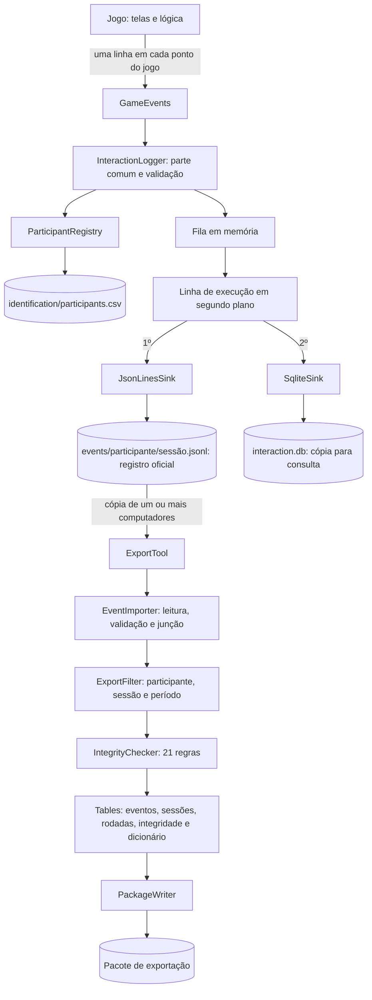

# Guia técnico do componente de registro e exportação dos dados de interação

Produto da **Etapa 8 (documentação e consolidação)** do projeto "Modelagem, registro e
persistência de dados de interação no Number Race". Este guia é o **ponto de partida** para quem
for usar ou continuar o componente. Ele reúne, num só lugar, o que está distribuído nos documentos
de cada etapa, e indica onde está o detalhe de cada assunto:

| Documento | Etapa | Conteúdo |
|---|---|---|
| [Registro de trabalho](registro-dados-interacao.md) | 1 a 8 | O que foi feito em cada etapa, resultados e andamento |
| [Catálogo de eventos](catalogo-eventos.md) | 2 | Eventos observáveis no jogo, com a sua origem no código, e o registro atual coluna por coluna |
| [Modelo de eventos](modelo-eventos.md), [JSON Schema](modelo-eventos.schema.json) e [exemplos](modelo-eventos-exemplos.json) | 3 (versão 1.1 na Etapa 7) | Estrutura de cada evento, campos, tipos e regras |
| [Estratégia de persistência](persistencia-eventos.md) e [estrutura do banco](persistencia-eventos.sql) | 4 | Alternativas avaliadas, prova de conceito, decisão e estrutura de gravação |
| [Componente de registro](componente-registro.md) | 5 | Implementação do registro no jogo |
| [Exportação dos dados](exportacao-dados.md) | 6 | Pacote de exportação, tabelas e reunião de dados de vários computadores |
| [Validação técnica dos registros](validacao-registros.md) | 7 | Testes, verificação de integridade, problemas encontrados e correções |

O guia segue a ordem em que normalmente se precisa das informações: o que é (seção 1), como é
organizado (seções 2 a 4), como usar (seções 5 e 6), como testar (seção 7) e o que foi decidido,
o que não é feito e o que pode ser feito depois (seções 8 a 10).

---

## 1. Visão geral

O componente registra, de forma estruturada, o que acontece durante o uso do Number Race
(apresentação dos números, respostas, tempos de resposta, acertos, ajustes de dificuldade,
movimentos no tabuleiro, pausas, recompensas) e disponibiliza esses dados para análise
posterior. Ele segue o fluxo previsto no plano de trabalho:

```
interação da criança -> evento de interação -> registro estruturado -> persistência -> exportação -> análise posterior
```

**O que o componente faz**

- Registra **23 tipos de evento**, definidos no [modelo de eventos](modelo-eventos.md) (versão 1.1),
  cada um com uma parte comum (identificação, sessão, participante, data e hora, sequência) e uma
  parte específica (`data`).
- Valida cada evento antes de gravar e grava em segundo plano, sem que o jogo espere nem seja
  interrompido por falhas do registro.
- Grava cada sessão num arquivo **JSON Lines** (registro oficial) e numa cópia **SQLite** (para
  consulta), no próprio computador, sem internet.
- Identifica os participantes por um **código pseudonimizado** (por exemplo, `PZRGW99`); a
  correspondência entre código e nome fica numa pasta separada, que nunca é exportada.
- Reúne os dados de um ou mais computadores, sem repetições, e gera um **pacote de exportação**
  com o dado bruto, tabelas em CSV (versão padrão e versão para o Excel em português), banco
  SQLite, dicionário de dados, relatórios e manifesto com impressões digitais (SHA-256).
- Confere **21 regras de integridade** em cada sessão exportada e informa erros e avisos.

**O que o componente não faz** (seção 11 do plano de trabalho e decisões D22 e D35)

- Não calcula indicadores, médias, taxas nem interpretações: as tabelas apenas reorganizam e
  contam o que está nos eventos.
- Não altera o registro anterior do jogo (pasta `Data`), que continua sendo gravado em paralelo.
- Não envia dados pela rede nem os criptografa.
- Não substitui procedimentos éticos e institucionais para o uso de dados de crianças. Todos os
  testes foram feitos com **dados simulados**.

**Estado nesta versão**

| Item | Situação |
|---|---|
| Modelo de eventos | Versão 1.1 (23 tipos; versão 1.0 preservada) |
| Registro no jogo | Concluído; integrado em 7 classes do jogo (cerca de 125 linhas) |
| Exportação | Concluída; 16 arquivos por pacote |
| Testes automatizados | 100 (JUnit 4), aprovados em Java 8 e Java 21, entre eles a conformidade de todos os eventos com o JSON Schema oficial |
| Testes com o jogo real | Execução por programa (4 sessões, 1.345 eventos) e testes manuais no Windows |
| Volume testado | 108.000 eventos (600 sessões) exportados e verificados em 23 s, com 128 MB de memória, em Java 8 |
| Dependência nova no jogo | `org.xerial:sqlite-jdbc` 3.53.4.0 |

## 2. Arquitetura

O componente tem duas partes independentes: o **registro**, que roda dentro do jogo, e a
**exportação**, que é um programa separado, executado depois, no mesmo computador ou em outro.



Princípios da arquitetura (detalhes em [componente-registro.md](componente-registro.md), seções
2 e 7, e em [exportacao-dados.md](exportacao-dados.md), seção 3):

- **Desacoplamento do jogo.** Somente a classe `GameEvents` conhece as classes do jogo. O jogo
  chama um método de uma linha em cada ponto relevante (por exemplo, `GameEvents.answered(...)`),
  e todo método de `GameEvents` captura qualquer erro (decisão D24).
- **O jogo nunca espera.** O evento entra numa fila e é gravado por uma única linha de execução em
  segundo plano, que preserva a ordem (D20). No Windows, com Java 8 de 32 bits, a gravação levou
  cerca de 25 ms por evento no SQLite, tempo que não é percebido no jogo por ocorrer em segundo
  plano.
- **JSON Lines primeiro.** Cada evento é gravado primeiro no arquivo JSON Lines, com gravação
  forçada no disco, e depois no SQLite. Se o SQLite falhar, o registro oficial continua (D15).
- **A exportação lê apenas o registro oficial** (os arquivos JSON Lines), nunca o banco de cada
  computador nem a pasta de identificação (D38, D21).

## 3. Mapa do código

Pacotes em `numberrace/numberrace-core/src/main/java/org/unicog/numberrace/analytics/` (a descrição
de cada pacote está no seu `package-info.java`).

**Registro** (`analytics`)

| Classe | Responsabilidade |
|---|---|
| `GameEvents` | Adaptador entre o jogo e o componente; um método por situação do jogo |
| `InteractionLogger` | Liga e desliga o registro, abre e fecha sessões, mantém o contexto (partida e rodada), numera, valida e enfileira os eventos |
| `InteractionEvent` | Um evento; gera a linha JSON; contém a versão do modelo (`SCHEMA_VERSION`) |
| `EventType` | Os 23 tipos de evento e o escopo de cada um (sessão, partida ou rodada) |
| `EventValidator` | Regras de validação, equivalentes ao JSON Schema; versões conhecidas (`KNOWN_VERSIONS`) |
| `Json` | Geração e leitura de JSON, sem bibliotecas externas |
| `EventSink`, `JsonLinesSink`, `SqliteSink` | Destinos de gravação |
| `SqliteSchema` | Estrutura do banco (`schema.sql`, nos recursos) |
| `ParticipantRegistry` | Códigos pseudonimizados dos participantes |

**Exportação** (`analytics.export`)

| Classe | Responsabilidade |
|---|---|
| `ExportTool` | Programa de linha de comando: opções, execução e mensagens |
| `EventImporter`, `ImportReport`, `SourceEvent`, `SessionData` | Leitura dos arquivos JSON Lines, validação, junção sem repetições e relatório |
| `ExportFilter` | Filtros por participante, sessão e período |
| `IntegrityChecker` | As 21 regras de integridade |
| `Table`, `Tables` | Montagem das tabelas e descrição de cada coluna (que gera o dicionário de dados) |
| `CsvWriter`, `CsvReader` | Escrita e leitura de CSV |
| `PackageWriter`, `PackageVerifier` | Gravação e conferência do pacote |

**Pontos do jogo alterados** (chamadas a `GameEvents` e métodos de leitura de valores que o jogo
já calculava): `GameObject`, `managers/NumCompManager`, `screens/ChoiceScreen`,
`screens/CharacterScreen`, `screens/SaveScreen`, `algorithms/GameTurn` e
`algorithms/NumCompAlgManager`. A lista de cada ponto e do evento correspondente está em
[componente-registro.md](componente-registro.md), seção 5.

**Outros arquivos**

| Arquivo | Conteúdo |
|---|---|
| `numberrace-core/src/main/resources/org/unicog/numberrace/analytics/schema.sql` | Estrutura do banco usada pelo jogo |
| `numberrace-core/src/test/java/org/unicog/numberrace/analytics/` | Testes automatizados (seção 7) |
| `numberrace-core/src/test/resources/org/unicog/numberrace/analytics/export/dados-reais/` | Seis sessões do jogo real da Etapa 7 (Windows e jogo executado por programa), compactadas, usadas nos testes de regressão |
| `numberrace-core/src/test/resources/org/unicog/numberrace/analytics/export/sessao-teste.jsonl` | Sessão de teste (180 eventos, gravada no Windows) |
| `numberrace/tools/exportar.bat` | Exportação com dois cliques no Windows |
| `evolution/pt/modelo-eventos.schema.json` | JSON Schema 1.1 (aceita eventos 1.0 e 1.1) |

## 4. Estrutura dos dados

**No computador onde o jogo é usado** (diretório da aplicação; por padrão
`%USERPROFILE%\NumberRace\v3` no Windows; detalhes em [persistencia-eventos.md](persistencia-eventos.md),
seção 7):

```
NumberRace/v3/
├── Data/                     registro anterior do jogo (sem alteração; contém nomes)
├── identification/
│   └── participants.csv      código, sobrenome, nome e data de criação (não exportado)
└── interaction-data/
    ├── events/
    │   └── <código do participante>/
    │       └── <AAAA-MM-DD>_<HHMMSS>_<session_id>.jsonl    uma sessão por arquivo
    ├── interaction.db        cópia para consulta (tabelas meta e event)
    └── native/               biblioteca nativa do SQLite
```

**Cada evento** (uma linha JSON, aqui dividida em várias linhas para leitura; detalhes em
[modelo-eventos.md](modelo-eventos.md), seções 2 a 7):

```json
{"schema_version":"1.1","event_id":"82cd4c8b-c01c-4f51-9720-00553ef24f34","event_type":"ANSWER",
 "timestamp":"2026-10-09T18:29:30.987-03:00","session_id":"5fb5269a-ab53-4ee9-bf7a-f8489e351cf4",
 "participant_id":"P4WVSUY","sequence_number":16,"activity":"number_comparison","game_number":1,
 "turn_number":1,"data":{"side":"right","response_time_ms":1584,
 "response_time_from_first_stimulus_ms":2787,"correct_larger":false,"correct_final":false}}
```

**No pacote de exportação** (detalhes em [exportacao-dados.md](exportacao-dados.md), seções 3 a 5,
e em [validacao-registros.md](validacao-registros.md), seção 4):

```
exportacao_AAAA-MM-DD_HHMMSS/
├── LEIA-ME.txt                 explicação do pacote
├── manifest.json               versões, filtros, quantidades, integridade e SHA-256 de cada arquivo
├── relatorio-importacao.txt    problemas nos arquivos de origem (linhas cortadas, repetições, conflitos)
├── relatorio-integridade.txt   resultado das 21 regras, por sessão
├── events.jsonl                dado bruto (fonte oficial)
├── interaction.db              SQLite: tabelas event, session, turn e integrity
├── csv/                        vírgula e ponto decimal (R, Python, outras ferramentas)
└── excel/                      ponto e vírgula e vírgula decimal (Excel em português)
    (em csv/ e excel/: events, sessions, turns, integrity e dicionario-dados)
```

| Tabela | Uma linha por | Colunas |
|---|---|---|
| `events` | evento | 11 |
| `sessions` | sessão | 28 |
| `turns` | rodada | 52 |
| `integrity` | ocorrência de uma regra de integridade | 9 |
| `dicionario-dados` | coluna das tabelas acima | 6 |

O significado de cada coluna está no `dicionario-dados.csv` do próprio pacote.

## 5. Uso pelo pesquisador

Esta seção pressupõe o jogo instalado e executado conforme o guia do ambiente
(`numberrace/docs/AMBIENTE.pt.md`). O repositório ainda não tem um pacote de instalação do jogo;
por isso, os passos abaixo usam o Eclipse.

### 5.1 Primeiro uso: jogar, exportar e abrir no Excel

Nos passos abaixo, `%USERPROFILE%` é a pasta do usuário no Windows (por exemplo,
`C:\Users\maria`). Para abrir qualquer pasta indicada com esse nome:

- aperte as teclas **Windows + R**; na janela "Executar", escreva o caminho, por exemplo
  `%USERPROFILE%\NumberRace\v3`, e clique em **OK**; o Explorador de Arquivos abre nessa pasta;
- ou abra o Explorador de Arquivos, clique na barra de endereço (no alto da janela), escreva o
  caminho e aperte **Enter**.

1. **Jogar.**
   1. No Eclipse, no **Package Explorer** (a lista de projetos à esquerda), abra o projeto
      `numberrace-core` e encontre o arquivo `Game.java`.
   2. Clique com o botão direito em `Game.java` → **Run As** → **Java Application**.
   3. No jogo, cadastre um aluno de teste (ou selecione um já cadastrado) e jogue algumas rodadas.
   4. Feche o jogo: tecla **Esc** → **Sair do jogo**, ou feche a janela.

   O registro começa na seleção do aluno e termina na troca de aluno, na saída pelo menu ou no
   fechamento da janela.
2. **Encontrar os dados.**
   1. Abra a pasta `%USERPROFILE%\NumberRace\v3\identification` (como explicado acima).
   2. Abra o arquivo `participants.csv` com o **Bloco de Notas** (botão direito no arquivo → **Abrir
      com** → **Bloco de Notas**). Cada linha tem o código do aluno (por exemplo, `P4WVSUY`) seguido
      do sobrenome, do nome e da data do cadastro. Anote o código do aluno de teste e feche o arquivo
      sem salvar.
   3. Os eventos ficam em `%USERPROFILE%\NumberRace\v3\interaction-data\events\<código>\`: uma
      pasta por aluno e um arquivo `.jsonl` por sessão. Não é preciso abrir esses arquivos; o
      exportador os lê.
3. **Exportar.**
   1. Confira se o jogo está fechado.
   2. No Eclipse, no projeto `numberrace-core`, encontre o arquivo `ExportTool.java` (pasta
      `src/main/java`, pacote `org.unicog.numberrace.analytics.export`).
   3. Botão direito em `ExportTool.java` → **Run As** → **Java Application**.
   4. Leia o resultado no **Console** (a janela na parte de baixo do Eclipse): quantos eventos e
      sessões foram encontrados, o resultado da verificação de integridade e, na linha "Pacote
      gravado em:", a pasta criada para esta exportação.
   5. Abra a pasta `%USERPROFILE%\NumberRace\v3\exportacoes`. Cada exportação cria uma pasta nova,
      com a data e a hora no nome (`exportacao_AAAA-MM-DD_HHMMSS`); abra a mais recente. Esta é a
      **pasta do pacote**, usada nos passos 4 e 5.
4. **Abrir no Excel.** Na pasta do pacote, abra a pasta `excel` e dê dois cliques em `turns.csv`.
   O Excel mostra uma linha por rodada, em colunas. O significado de cada coluna está no arquivo
   `dicionario-dados.csv`, na mesma pasta.
5. **Ler os relatórios.** Na própria pasta do pacote (fora das pastas `csv` e `excel`), dê dois
   cliques nos dois arquivos de texto: `relatorio-integridade.txt` informa se alguma das 21 regras
   encontrou erro ou aviso; `relatorio-importacao.txt` informa problemas nos arquivos lidos. Os dois
   abrem no Bloco de Notas.

### 5.2 Exportar só um participante (passo a passo)

O exportador aceita **opções**: palavras escritas depois do nome do programa, que mudam o que ele faz.
No Eclipse, as opções ficam na configuração de execução do `ExportTool`, que é criada na primeira
vez que ele é executado (passo 3 da seção 5.1).

1. No menu do Eclipse, clique em **Run** → **Run Configurations...**.
2. Na lista da esquerda, em **Java Application**, clique em **ExportTool**.
3. Clique na aba **Arguments**.
4. Na caixa **Program arguments**, escreva `--participante` seguido de um espaço e do código do
   aluno, anotado no passo 2 da seção 5.1. Exemplo: `--participante P4WVSUY`.
5. Clique em **Apply** e depois em **Run**.
6. No Console, a linha "Sessões encontradas: X; selecionadas: Y" mostra quantas sessões havia ao
   todo (X) e quantas foram exportadas (Y, só as daquele aluno). O pacote é criado como no passo 3
   da seção 5.1.
7. **Ao terminar, volte à aba Arguments, apague o texto da caixa Program arguments e clique em
   Apply.** Senão as próximas exportações continuarão saindo só com esse aluno.

As outras opções (seção 5.3) são usadas do mesmo jeito, na mesma caixa. Várias opções podem ser
escritas juntas, separadas por espaço, por exemplo `--participante P4WVSUY --zip`.

### 5.3 Outras tarefas

| Tarefa | Como fazer |
|---|---|
| Exportar só um participante, uma sessão ou um período | Opções `--participante <código>`, `--sessao <id>`, `--de AAAA-MM-DD`, `--ate AAAA-MM-DD`, escritas como na seção 5.2 |
| Juntar dados de vários computadores | Copiar a pasta `interaction-data` de cada computador (nunca a pasta `identification`) e usar `--entrada <pasta>` uma vez para cada cópia. Eventos repetidos são ignorados pelo `event_id` (D36) |
| Gerar também um `.zip` | Opção `--zip` |
| Conferir um pacote recebido | `--verificar <pasta do pacote>`: confere cada arquivo com o manifesto |
| Exportar com dois cliques | `exportar.bat`, colocado na pasta do jogo, ao lado da pasta `lib` com os JARs |
| Ler os dados em Python | `pandas.read_csv("csv/turns.csv")` (testado) |
| Ler os dados em R | `read.csv("csv/turns.csv")` (descrito no LEIA-ME; não testado) |
| Consultar com SQL | Abrir `interaction.db` do pacote, por exemplo com o DB Browser for SQLite |

Todas as opções: `--ajuda`. Códigos de saída: 0 (concluído), 1 (erro) e 2 (conferência com
problemas). Detalhes em [exportacao-dados.md](exportacao-dados.md), seção 7.

### 5.4 Cuidados com os dados

- A pasta `identification/` liga o código ao nome da criança: **não deve ser copiada junto com os
  dados** nem enviada para análise. O exportador nunca a lê.
- A pasta `Data/` do registro anterior do jogo contém nome, idade e sexo; o componente não a usa.
- O pacote não é criptografado: a proteção depende de onde ele é guardado e de quem tem acesso.
- `TURN_START.representation.spoken` informa a condição prevista pelo nível. Enquanto o problema
  P9 não for corrigido, os números do personagem da criança não são ouvidos nesses níveis
  ([validacao-registros.md](validacao-registros.md), seção 10).
- O tempo de resposta inclui o tempo em que o jogo ficou pausado durante a espera; a tabela
  `turns` informa as pausas de cada rodada (D48).

## 6. Uso pelo desenvolvedor

### 6.1 Compilar, testar e configurar

- Ambiente: `numberrace/docs/AMBIENTE.pt.md`. O código do componente é compatível com Java 8; a
  compilação também funciona com JDK 21.
- Compilar e executar os testes: `mvn clean package` na pasta `numberrace/` (no Eclipse: Run As →
  Maven build → `clean package`).
- Configuração por propriedades do Java (`-D...`):

| Propriedade | Efeito |
|---|---|
| `numberrace.analytics.clickIgnored=false` | Desliga o registro de cliques antes da liberação da resposta (D29) |
| `org.sqlite.tmpdir` | Pasta da biblioteca nativa do SQLite; se não for definida, o componente usa `interaction-data/native/` (D19) |

- Mensagens do componente: *logger* `org.unicog.numberrace.analytics` (`java.util.logging`).
  Falhas de gravação aparecem apenas ali; o jogo não as mostra.

### 6.2 Receita: um tipo de evento novo

Exemplo: registrar quando a criança pede ajuda (funcionalidade inexistente hoje). Um tipo novo é
uma mudança de **versão menor** do modelo (por exemplo, 1.1 → 1.2), porque os dados antigos
continuam válidos ([modelo-eventos.md](modelo-eventos.md), seção 11).

1. **Modelo.** Em `evolution/pt/modelo-eventos.md`: descrever o tipo e os campos (seção 7),
   relacioná-lo à lista do plano (seção 9) e acrescentar a versão no histórico (seção 11.1).
2. **Schema.** Copiar o schema atual para `modelo-eventos-1.1.schema.json` (preservar a versão
   anterior) e, em `modelo-eventos.schema.json`, acrescentar o tipo e a regra dos seus campos,
   aceitando-o apenas a partir da nova versão (como foi feito para `window_focus`).
3. **Código do registro.**
   - `EventType`: novo valor, com o escopo (sessão, partida ou rodada).
   - `EventValidator`: regras dos campos e a nova versão em `KNOWN_VERSIONS`.
   - `InteractionEvent.SCHEMA_VERSION`: nova versão.
   - `GameEvents`: um método novo, que captura qualquer erro, chamado com uma linha no ponto
     certo do jogo.
4. **Exportação** (se o evento deve aparecer nas tabelas): colunas em `Tables`, com descrição,
   unidade e origem, que alimentam o dicionário de dados. Se houver uma relação que deva sempre
   valer, uma regra em `IntegrityChecker` (receita 6.5).
5. **Testes.** Casos válidos e inválidos em `EventValidatorTest`, um exemplo novo em
   `modelo-eventos-exemplos.json` e o tipo novo no gerador `SimulatedSessions` (o teste
   `sessoesSimuladasSaoValidasECoerentes` falha enquanto algum tipo do modelo não aparecer nos
   dados gerados). O `SchemaConformanceTest` confere sozinho esses eventos contra o schema novo.
6. **Documentos.** `CHANGELOG.md`, [componente-registro.md](componente-registro.md) (pontos de
   integração) e este guia.

### 6.3 Receita: um campo novo num evento existente

- **Campo opcional** (dados antigos continuam válidos): versão menor; passos 1 a 6 da receita
  anterior, sem novo `EventType`.
- **Renomear, remover ou mudar o significado** de um campo: **versão maior** (2.0). Exige
  preservar o schema 1.x, aceitar as duas versões na importação e indicar a versão nas tabelas.

### 6.4 Receita: uma coluna nova nas tabelas ou um formato novo de exportação

- **Coluna:** acrescentar em `Tables` com `column(nome, tipo, unidade, descrição, origem)`. O
  dicionário de dados e as versões `csv/` e `excel/` são gerados automaticamente. As tabelas só
  devem reorganizar e contar o que está nos eventos (D35); indicadores ficam para a análise.
- **Formato** (por exemplo, Parquet ou um arquivo para outra ferramenta): o ponto de partida é
  `PackageWriter`, que recebe as tabelas prontas (`Table`). O arquivo novo deve entrar no
  manifesto (SHA-256), no LEIA-ME e no teste `ExportToolTest`, que confere a lista de arquivos do
  pacote.

### 6.5 Receita: uma regra de integridade nova

1. Em `IntegrityChecker`, declarar a regra com `rule("R22", Severity.ERROR ou WARNING, descrição)`.
   Usar **erro** para dados incoerentes e **aviso** quando houver explicação legítima possível (D42).
2. Implementar a verificação no percurso da sessão.
3. Em `IntegrityCheckerTest`: confirmar que a sessão de teste continua sem ocorrências e criar um
   estrago proposital que só a nova regra perceba.
4. Atualizar a tabela de regras em [validacao-registros.md](validacao-registros.md), seção 4.

### 6.6 Receita: mudar a estrutura do banco

O banco é uma cópia: em vez de migrar, recria-se o banco e reimporta-se o JSON Lines (D23).
Alterar `schema.sql` (jogo) ou `SqliteSchema` e incrementar `storage_version` na tabela `meta`.

## 7. Procedimentos de teste

| Tipo | Como executar | O que cobre |
|---|---|---|
| Testes automatizados | `mvn clean package` (100 testes, cerca de 22 s; um é ignorado quando não se informa uma pasta de saída) | Validação, gravação, concorrência, JSON, códigos de participante, falhas da gravação, CSV, importação, exportação, integridade, sessões simuladas, conformidade com o JSON Schema e regressão com dados do jogo real |
| Dados simulados | `mvn -pl numberrace-core -am test -Dtest=SimulatedSessionsTest -Dsurefire.failIfNoSpecifiedTests=false -Dsimulados.saida=<pasta>` | 3 participantes × 2 sessões, os 23 tipos (semente fixa, sempre os mesmos dados) |
| Integridade de qualquer conjunto de dados | Executar a exportação e ler `relatorio-integridade.txt` | As 21 regras |
| Conferência de um pacote | `ExportTool --verificar <pasta>` | Impressões digitais do manifesto |
| Teste manual no Windows | Roteiro em [validacao-registros.md](validacao-registros.md), seção 9 | Jogo real: erros, prazo esgotado, pausas, armadilhas, recompensa, encerramentos |

Testes automatizados por classe:

| Classe de teste | Testes | Assunto |
|---|---|---|
| `EventValidatorTest` | 7 | Regras de validação e versões do modelo |
| `InteractionLoggerTest` | 4 | Sessão, contexto, numeração e gravação |
| `InteractionLoggerConcurrencyTest` | 4 | Várias linhas de execução ao mesmo tempo, destino lento, destino com defeito |
| `GameEventsRobustnessTest` | 1 | Nenhuma exceção do registro chega ao jogo |
| `JsonTest` | 5 | Geração e leitura de JSON |
| `JsonRoundTripTest` | 5 | Ida e volta de textos e números; linhas cortadas ou corrompidas |
| `ParticipantRegistryTest` | 8 | Códigos dos participantes, inclusive arquivo salvo pelo Excel |
| `PersistenceFailureTest` | 5 | Fechamento à força, banco bloqueado, pasta impossível, disco cheio, relógio atrasado |
| `CsvWriterTest` | 3 | CSV nas duas versões |
| `EventImporterTest` | 6 | Junção de pastas, repetições, conflitos, linhas cortadas |
| `ExportToolTest` | 4 | Pacote completo e conferido, arquivo alterado detectado, filtros e opções inválidas |
| `IntegrityCheckerTest` | 18 | Sessão de teste sem ocorrências e os 18 estragos propositais (dois deles no mesmo teste) |
| `TablesTest` | 5 | Tabelas derivadas |
| `SimulatedSessionsTest` | 5 | Sessões geradas válidas e sem ocorrências |
| `SchemaConformanceTest` | 5 | Exemplos, eventos do jogo real e sessões simuladas válidos pelo JSON Schema; teste diferencial com o validador |
| `RealDataRegressionTest` | 4 | Exportação das sessões do jogo real: contagens, integridade e resultado repetível |
| `CsvRoundTripTest` | 3 | Ida e volta de textos nas duas versões do CSV |
| `ImportEdgeCasesTest` | 5 | Arquivos com BOM, CRLF, lixo, linha enorme, aninhamento exagerado; pasta inexistente |
| `FilterAndVerifierTest` | 3 | Filtros com sessões inteiras; conferência de pacote adulterado |

Ao alterar o componente, a regra é: todos os testes aprovados em Java 8, a sessão de teste
(`sessao-teste.jsonl`) sem nenhuma ocorrência de integridade e todos os eventos válidos pelo
JSON Schema (`SchemaConformanceTest`). O validador usado durante o jogo confere só a estrutura dos
eventos; o tipo e o valor de cada campo são conferidos por esse teste. O método de teste e os resultados
estão em [validacao-registros.md](validacao-registros.md).

## 8. Decisões técnicas

Índice das 50 decisões. A justificativa de cada uma está no documento indicado. Nenhuma decisão
foi substituída até esta versão; algumas foram detalhadas por decisões posteriores, como indicado.

| # | Assunto | Decisão | Documento |
|---|---|---|---|
| D1 | Cliques antes da liberação da resposta | Registrar, de forma configurável (implementada em D29) | [Catálogo](catalogo-eventos.md) |
| D2 | Cliques nas casas do tabuleiro | Resultado de cada movimento e tentativas além da casa correta; clique a clique como extensão | Catálogo |
| D3 | Estado do algoritmo adaptativo | Registrar | Catálogo |
| D4 | Acerto no evento de resposta | Registrar `respCorr` e `finalCorr`, identificados como derivados | Catálogo |
| D5 | Estrutura do evento | Parte comum e parte específica em `data` | [Modelo](modelo-eventos.md) |
| D6 | Nomes de campos | *snake_case* | Modelo |
| D7 | Estímulo, resposta e resultado | Eventos separados; visão por rodada na exportação | Modelo |
| D8 | Tempo de resposta | Desde a liberação da resposta; também desde o primeiro estímulo | Modelo |
| D9 | Prazo esgotado | Evento próprio, sem tempo de resposta | Modelo |
| D10 | Eventos fora da sessão | Não registrados; idioma no início da sessão | Modelo |
| D11 | Menu | `PAUSE`/`RESUME` com `trigger = menu` (ampliado por D44) | Modelo |
| D12 | Movimentos | Um tipo (`MOVE`) com o campo `piece` | Modelo |
| D13 | Identificadores | UUID para evento e sessão; sequência por sessão | Modelo |
| D14 | Data e hora | ISO 8601 com milissegundos e fuso | Modelo |
| D15 | Arquitetura de persistência | JSON Lines oficial e SQLite como cópia | [Persistência](persistencia-eventos.md) |
| D16 | Organização dos arquivos | Um arquivo por sessão, uma pasta por participante | Persistência |
| D17 | Local dos dados | `interaction-data/` no diretório da aplicação, em disco local | Persistência |
| D18 | Estrutura do banco | Parte comum em colunas e evento completo em JSON | Persistência |
| D19 | Biblioteca nativa do SQLite | Extraída para `interaction-data/native/` | Persistência |
| D20 | Gravação | Em segundo plano, gravação forçada no disco a cada evento; falhas só no log | Persistência |
| D21 | Identificação dos participantes | Em `identification/`, fora dos dados | Persistência |
| D22 | Registro anterior do jogo | Mantido sem alteração, em paralelo | Persistência |
| D23 | Migração do banco | Recriar e reimportar o JSON Lines | Persistência |
| D24 | Integração com o jogo | Chamadas de uma linha a `GameEvents`; só ele conhece o jogo | [Componente](componente-registro.md) |
| D25 | Código do participante | `P` + 6 caracteres sorteados, reutilizado pelo mesmo nome | Componente |
| D26 | Limites da sessão | Da seleção do aluno até a troca de aluno ou o fechamento | Componente |
| D27 | Validação | Regras de estrutura em código; tipo e valor dos campos conferidos contra o JSON Schema nos testes; evento inválido descartado sem consumir sequência (detalhada por D44) | Componente |
| D28 | Medição do tempo | Relógio monotônico do componente | Componente |
| D29 | Cliques ignorados | Registrados por padrão, com opção de desligar | Componente |
| D30 | Geração de JSON | Código próprio, sem biblioteca | Componente |
| D31 | Onde a exportação é executada | Programa separado (`ExportTool`), Eclipse ou `exportar.bat` | [Exportação](exportacao-dados.md) |
| D32 | Formato | Pacote com dado bruto, CSV, SQLite, dicionário, relatórios e manifesto | Exportação |
| D33 | Separador e decimal | Duas versões: `csv/` e `excel/` | Exportação |
| D34 | Contas nos estímulos | Operador e números em colunas separadas | Exportação |
| D35 | Tabelas derivadas | Só reorganização e contagens | Exportação |
| D36 | Reunião de computadores | Junção pelo `event_id`; conflitos relatados | Exportação |
| D37 | Seleção | Filtros sempre com sessões inteiras | Exportação |
| D38 | Fonte dos dados | Somente os arquivos JSON Lines | Exportação |
| D39 | Integridade do pacote | Manifesto com SHA-256 | Exportação |
| D40 | Uso de memória | Linhas em UTF-8 e tabela de eventos gravada sem ficar inteira na memória | Exportação |
| D41 | Verificação de integridade | Dentro do exportador, sem impedir a exportação | [Validação](validacao-registros.md) |
| D42 | Gravidade | Erro e aviso | Validação |
| D43 | Saída no meio da partida | Não é problema | Validação |
| D44 | Pausa por perda de foco | Modelo 1.1 com `trigger = window_focus` | Validação |
| D45 | Ordem no prazo esgotado | Registro antes da fala do adversário | Validação |
| D46 | Numeração das recompensas | 1 a 7, como no modelo | Validação |
| D47 | Gravação interrompida | Linha incompleta isolada | Validação |
| D48 | Tempo de resposta com pausa | Mantido como medido e documentado | Validação |
| D49 | Dados para os testes | Sessão de teste, gerador, jogo executado por programa e teste manual | Validação |
| D50 | Documentação consolidada | Este guia como entrada, mantidos os documentos de cada etapa | [Registro de trabalho](registro-dados-interacao.md), seção 9 |

## 9. Limitações

Lista única das limitações registradas nas etapas, com a situação nesta versão.

**Resolvidas em etapas posteriores**

| Limitação ou observação | Registrada em | Situação |
|---|---|---|
| Pausa por perda de foco da janela não registrada | Componente (Etapa 5) | Resolvida na Etapa 7 (modelo 1.1, D44) |
| `HAZARD` e `CHARACTER_UNLOCKED` não observados em execução | Componente (Etapa 5) | Observados na Etapa 7 (jogo executado por programa; armadilhas também no Windows) |
| Importação para o SQLite e exportação inexistentes | Persistência e Componente | Resolvidas na Etapa 6 |
| Interrupção forçada e disco cheio não testados | Persistência (Etapa 4) | Testados na Etapa 7 (fechamento à força real; disco cheio simulado) |
| `SESSION_START.display_mode` não preenchido | Componente (Etapa 5) | Resolvida na Etapa 7 (P8) |

**Em aberto**

| Limitação | Consequência | Referência |
|---|---|---|
| Números do personagem da criança não são reproduzidos nos níveis com números falados (defeito do jogo, P9) | `representation.spoken` indica a condição prevista, não a reprodução efetiva | Validação, seção 10 |
| O tempo de resposta inclui pausas durante a espera | Rodadas com pausa devem ser tratadas na análise (a tabela `turns` as identifica) | D48 |
| O validador usado durante o jogo confere só a estrutura do evento | Um valor fora do modelo, causado por um defeito futuro do jogo, seria gravado; os testes de conformidade com o JSON Schema detectam | Validação, seção 13 |
| O código do participante depende do nome digitado | Grafias diferentes geram códigos diferentes; homônimos recebem o mesmo código | Componente, seção 12 |
| Falha na gravação do JSON Lines | O evento fica só no SQLite; aparece uma lacuna na sequência (regra R01) | Componente, seção 12 |
| O jogo não avisa quando o registro está desligado ou com falha | O problema aparece apenas no log | Componente, seção 12 |
| Dados e pacotes não criptografados | A proteção depende do local e do acesso | Persistência, seção 10; Exportação, seção 8 |
| Sem pacote de instalação do jogo; exportação sem janela gráfica | Uso pelo Eclipse ou pelo `exportar.bat` ao lado da pasta `lib` | Exportação, seção 12 |
| O exportador não encontra sozinho uma pasta de dados configurada em outro local | Usar `--entrada` | Exportação, seção 12 |
| Leitura em R não executada; macOS e tela cheia não testados; queda de energia real não testada | Testar antes de depender desses cenários | Exportação e Validação |
| A verificação de integridade confere a coerência do registro, não as regras do jogo nem do algoritmo | Erros do próprio jogo não são detectados | Validação, seção 13 |
| Regras do tabuleiro (R13 a R15) confirmadas com 15 partidas reais | Situações raras podem exigir ajuste | Validação, seção 13 |
| Personagens e animais registrados por índice | A correspondência entre índice, nome e imagem ainda não está documentada | Modelo, seção 14 |
| `message_key` usa o nome do arquivo de áudio | Renomear os áudios exige manter a correspondência | Modelo, seção 14 |
| Java 24 ou mais novo | A biblioteca do SQLite emite avisos de acesso nativo; poderá exigir `--enable-native-access=ALL-UNNAMED` | Validação, seção 13 |

**Fora do escopo** (seção 11 do plano e decisões D22 e D24): estudos com crianças, diagnóstico,
interpretação clínica, análises estatísticas, inteligência artificial, alteração do registro
anterior do jogo e refatoração do código do jogo.

## 10. Possibilidades de evolução

Organizadas conforme a seção 13 do plano de trabalho ("continuidade do trabalho").

| Extensão prevista no plano | Como fazer com o componente atual |
|---|---|
| Novos tipos de eventos | Receita 6.2. Já previstos no modelo: registro clique a clique no tabuleiro (D2), outras atividades (`activity`) e ajuda à criança, se o jogo ganhar essa funcionalidade |
| Novos campos | Receita 6.3 (versão menor para campos opcionais) |
| Novos formatos de exportação | Receita 6.4 (`PackageWriter`) |
| Consultas | Consultas SQL sobre o `interaction.db` do pacote (tabelas `event`, `session`, `turn` e `integrity`); consultas frequentes podem virar visões (*views*) no banco |
| Visualizações | A partir de `turns.csv` e `sessions.csv`, sem alterar o registro |
| Indicadores derivados | Calculados numa camada de análise separada, a partir do dado bruto, mantendo a separação entre dado observado e indicador (`evolucao-ads.md`, seção 10) |
| Análises longitudinais | O código do participante é estável entre sessões e computadores (D25), e `sessions` traz o número da sessão de cada participante |
| Integração com ferramentas de análise | Os pacotes já são lidos por pandas e por SQL; o JSON Schema permite validar os dados em qualquer linguagem |
| Integração com outras pesquisas | Parte comum estável e campo `activity` para outras atividades; versões do modelo preservadas |

Outras melhorias identificadas nas etapas:

- correção dos sons dos números do personagem da criança (P9) e dos áudios ausentes, em
  contribuição separada;
- aviso na tela quando o registro estiver desligado ou com falha;
- janela gráfica para a exportação e pacote de instalação do jogo com o `exportar.bat`;
- documentação da correspondência entre os índices de personagens e animais e os seus nomes;
- criptografia dos dados, se a equipe de pesquisa exigir;
- testes em macOS, em tela cheia e de leitura em R;
- refatoração do jogo para notificar eventos por observadores (por exemplo, ampliando
  `GameListener`), o que reduziria as chamadas espalhadas no código do jogo; proposta para um
  projeto posterior.
